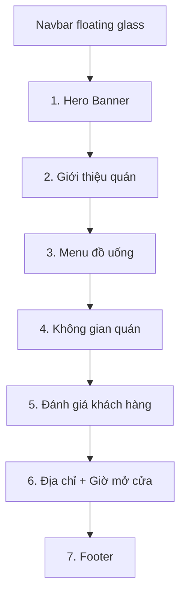

# BlueIsland Coffee: Đề xuất Design System & Cấu trúc trang

> [!NOTE]
> Công cụ `ui-ux-pro-max --design-system` mặc định trả về bảng màu **nâu cà phê + vàng** (theo ngành Cafe). Mình đã **điều chỉnh** bằng các tìm kiếm bổ sung (color "ocean/coastal", typography "vietnamese", landing "testimonial") để khớp yêu cầu tông xanh biển + trắng. Phần **pattern trang** và **anti-patterns** vẫn giữ theo gợi ý của tool.

---

## 1. Concept

**"Một hòn đảo nhỏ giữa phố"**: một góc yên tĩnh, thoáng như biển dành cho sinh viên học bài và dân văn phòng làm việc/gặp gỡ.

- Từ khóa: *thoáng, mát, sạch, thư giãn, hiện đại, thân thiện*
- Cảm xúc mong muốn: mở web là thấy "dịu mắt", như gió biển.

---

## 2. Bảng màu

| Vai trò | Tên | Hex | Dùng cho |
|---|---|---|---|
| Primary | Ocean Blue | `#0369A1` | Nút chính, link, icon, điểm nhấn |
| Primary Dark | Deep Sea | `#0C4A6E` | Tiêu đề, nền footer, overlay hero |
| Secondary | Lagoon | `#06B6D4` | Badge, hover, sóng trang trí, gradient |
| CTA | Ocean Blue (`#0369A1`), chữ trắng | `#0369A1` | Nút chính ("Xem menu", "Chỉ đường"), hover sang Deep Sea `#0C4A6E` |
| CTA trên nền tối | White, chữ Ocean Blue | `#FFFFFF` | Nút trên hero/footer xanh đậm |
| Light Blue | Shallow Water | `#E0F2FE` | Badge, tag menu, nền icon |
| Background | White | `#FFFFFF` | Nền chính |
| Background alt | Sea Foam | `#F0F9FF` | Nền section xen kẽ, card |
| Text | Ink | `#0F172A` | Nội dung chính |
| Text muted | Slate | `#475569` | Mô tả phụ (tối thiểu, không nhạt hơn) |
| Border | Mist | `#E2E8F0` | Viền card, divider |

**Gradient hero:** `#0C4A6E → #0369A1 → #06B6D4` (biển sâu → mặt nước → san hô nông).

> [!TIP]
> Bảng màu **chỉ có xanh biển và trắng**. Nút nổi bật nhờ tương phản đậm/nhạt: nút xanh đặc trên nền trắng và nút trắng trên nền xanh đậm. Chữ trắng trên `#0369A1` đạt tương phản khoảng 5.9:1 (chuẩn AA).

---

## 3. Typography

| Vai trò | Font | Weights | Lý do |
|---|---|---|---|
| Heading | **Be Vietnam Pro** | 600 / 700 / 800 | Hỗ trợ tiếng Việt rất tốt, hiện đại, có cá tính |
| Body | **Be Vietnam Pro** (fallback **Noto Sans**) | 400 / 500 | Dễ đọc, dấu tiếng Việt chuẩn |
| Accent (tùy chọn) | **Playfair Display** *italic* | 500 | Chỉ dùng cho tagline/quote đánh giá, tạo nét "cafe" thanh lịch |

```css
@import url('https://fonts.googleapis.com/css2?family=Be+Vietnam+Pro:wght@400;500;600;700;800&family=Playfair+Display:ital,wght@1,500&display=swap');
```

**Type scale:** H1 `clamp(2.5rem, 6vw, 4.5rem)` · H2 `2.25rem` · H3 `1.25rem` · Body `1rem / 1.7` · Small `0.875rem`

---

## 4. Phong cách UI

**Modern Minimal + Soft Glassmorphism + Organic Waves**

| Yếu tố | Quy tắc |
|---|---|
| Bo góc | Card `rounded-2xl` (16px), nút `rounded-full` (pill), giống viên sỏi biển |
| Đổ bóng | Mềm, ám xanh: `0 10px 30px -10px rgba(3,105,161,0.25)` |
| Glass | Navbar & card trên hero: `bg-white/80 backdrop-blur` (không dùng `/10`, vì quá mờ ở light mode) |
| Divider | **SVG sóng** giữa các section thay cho đường thẳng, tạo dấu ấn "biển đảo" |
| Icon | Lucide SVG (cốc, wifi, ổ cắm, đồng hồ, map-pin…). **Không dùng emoji** |
| Ảnh | Ảnh thật sáng, tông mát; overlay gradient xanh trên hero |
| Motion | Fade-up nhẹ khi scroll (200–300ms), sóng hero chuyển động chậm; tôn trọng `prefers-reduced-motion` |
| Hover | Đổi màu / shadow, **không scale** gây xô lệch layout; `cursor-pointer` cho mọi phần tử click được |
| Container | `max-w-6xl` đồng nhất toàn trang |
| Navbar | Floating (cách mép `top-4`), glass, sticky, có nút CTA xanh "Xem menu" |

**Tránh (anti-patterns):** thiết kế chung chung thiếu không khí · nền xanh đậm toàn trang gây nặng · chữ xám nhạt khó đọc · quá nhiều hiệu ứng.

---

## 5. Cấu trúc trang (One-page landing)



| # | Section | Nền | Nội dung & layout |
|---|---|---|---|
| 0 | **Navbar** | Glass trắng | Logo BlueIsland (sóng + cốc) · Giới thiệu · Menu · Không gian · Đánh giá · Liên hệ · CTA xanh "Xem menu". Mobile: hamburger |
| 1 | **Hero** | Ảnh + gradient xanh, sóng SVG ở đáy | H1: *"Một hòn đảo nhỏ giữa lòng phố"* · tagline · 2 CTA: "Xem menu" (nền trắng, chữ xanh) + "Chỉ đường" (viền trắng) · 3 badge nhanh: Wifi mạnh · Ổ cắm mọi bàn · Mở đến 22h |
| 2 | **Giới thiệu** | Sea Foam `#F0F9FF` | 2 cột: ảnh bo góc lệch tầng ↔ câu chuyện quán + 3–4 điểm mạnh dạng icon card (Không gian học/làm việc yên tĩnh · Giá thân thiện sinh viên · Hạt cà phê chọn lọc · Nhân viên thân thiện) |
| 3 | **Menu đồ uống** | Trắng | Tab lọc: Cà phê · Trà & Trà trái cây · Đá xay · Signature (vd. "Blue Ocean Soda", "Muối biển Latte"). Grid card 3 cột (ảnh, tên, mô tả ngắn, giá, nhãn "Best seller"/"Mới") |
| 4 | **Không gian quán** | Sea Foam `#F0F9FF` | Gallery dạng masonry/bento (5–6 ảnh): khu học nhóm, góc làm việc một mình, ban công, quầy bar. Click mở lightbox. Caption ngắn mỗi khu |
| 5 | **Đánh giá** | Trắng | 3 card (hoặc carousel trên mobile): avatar, tên, vai trò (Sinh viên ĐH…, Nhân viên văn phòng), 5 sao SVG, quote font Playfair italic. Thêm dải số liệu: *4.8★ Google · 10.000+ khách · 30+ món* |
| 6 | **Địa chỉ + Giờ mở cửa** | Sea Foam `#F0F9FF` | 2 cột: Google Maps embed ↔ card thông tin: địa chỉ, giờ mở cửa (bảng T2–CN, highlight ngày hôm nay + trạng thái "Đang mở/Đã đóng"), SĐT, nút "Chỉ đường" |
| 7 | **Footer** | Deep Sea `#0C4A6E`, sóng ở đỉnh | Logo + slogan · liên kết nhanh · liên hệ · mạng xã hội (Facebook, Instagram, TikTok, icon từ Simple Icons) · © 2026 BlueIsland |

---

## 6. Kỹ thuật đề xuất

- **Stack:** HTML + Tailwind CSS (mặc định của skill), có JS nhẹ cho tab menu, lightbox, trạng thái "Đang mở".
- **Responsive:** kiểm tra ở 375 / 768 / 1024 / 1440px, không cuộn ngang trên mobile.
- **Accessibility:** alt cho mọi ảnh, focus ring rõ, tương phản ≥ 4.5:1, thẻ HTML ngữ nghĩa.
- Lưu design system vào `design-system/MASTER.md` trong project khi bắt đầu code.
